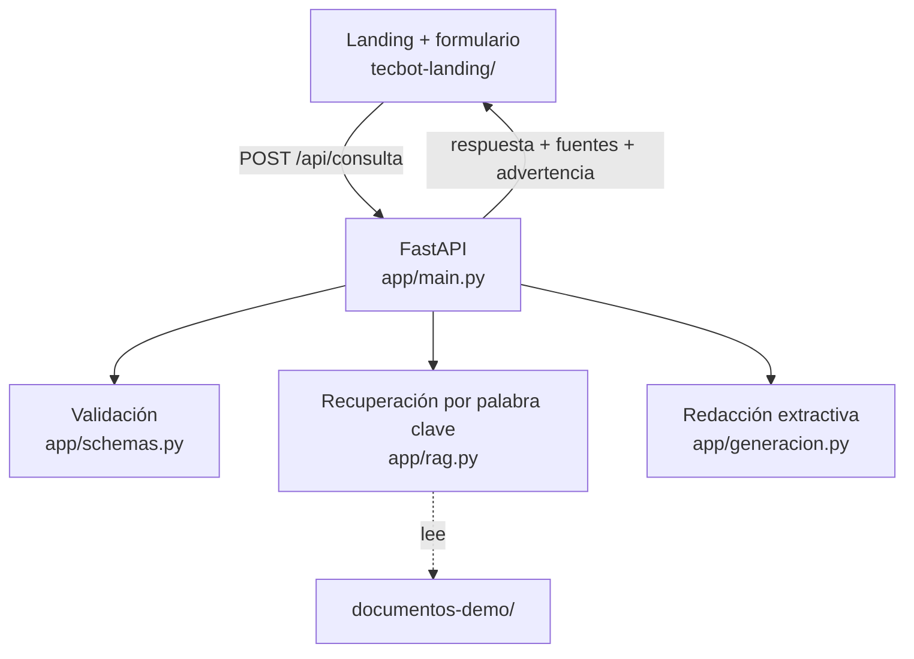
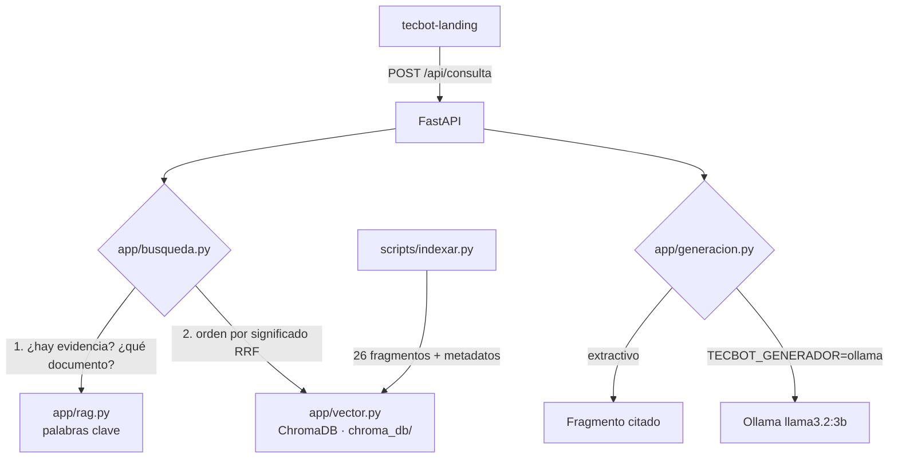

# Arquitectura — TecBot Académico

> **Documento de demostración del curso.** Describe un prototipo didáctico, no una infraestructura institucional.

## 1. Vista general (Día 2)



En el Día 3 la recuperación pasa a ChromaDB y la redacción puede usar un modelo (Ollama u otro proveedor). Las firmas de `recuperar_fragmentos` y `generar_respuesta` no cambian.

## 1.1 Vista Día 3 (RAG con ChromaDB)



Fragmentación para ChromaDB: una entrada por sección `## ` (se omiten Propósito, Alcance, Límites y Fuente), subdividida si pasa de 800 caracteres con 120 de solapamiento. El texto indexado lleva el encabezado de la sección. Metadatos: `documento`, `tema`, `seccion`, `fragmento`, `tipo`. Métrica: coseno. Embeddings: `DefaultEmbeddingFunction` (all-MiniLM-L6-v2), el mismo al indexar y al consultar.

## 2. Componentes

| Componente | Archivo | Responsabilidad |
|---|---|---|
| Interfaz | `tecbot-landing/` | Formular la pregunta y mostrar respuesta, fuentes y estados (carga, vacío, error) |
| API | `app/main.py` | Validar, orquestar y devolver el contrato; servir la landing en `/` |
| Contrato | `app/schemas.py` | Modelos Pydantic de entrada y salida |
| Recuperación | `app/rag.py` | Fragmentar por sección, puntuar con IDF y decidir si hay evidencia |
| Redacción | `app/generacion.py` | Construir la respuesta con el fragmento principal, sin agregar datos |

## 3. Contrato de la API

### `GET /salud`

```json
{ "estado": "ok" }
```

### `POST /api/consulta`

Entrada (1 a 1,000 caracteres; espacios al inicio y al final se ignoran):

```json
{ "pregunta": "¿Qué necesito para el servicio social?" }
```

Respuesta con evidencia (200):

```json
{
  "respuesta": "Según «Servicio social · Requisitos para iniciar» (servicio-social.md): ...",
  "fuentes": [
    {
      "documento": "servicio-social.md",
      "tema": "servicio-social",
      "seccion": "Servicio social · Requisitos para iniciar",
      "fragmento": "Para este ejercicio, el documento de demostración establece..."
    }
  ],
  "advertencia": null
}
```

Sin evidencia (200):

```json
{
  "respuesta": "No encontré información suficiente en los documentos disponibles.",
  "fuentes": [],
  "advertencia": "Acude al departamento correspondiente para confirmar esta información."
}
```

Pregunta vacía, solo espacios o mayor a 1,000 caracteres: **422**.

## 4. Algoritmo de recuperación (Día 2)

1. Cada documento se divide por encabezados `## `. Se omiten las secciones que describen al documento (Propósito, Alcance, Límites, Fuente y vigencia).
2. Texto normalizado: minúsculas, sin acentos, sin palabras vacías; cada palabra se reduce a sus primeros 6 caracteres ("acreditar" y "acreditación" → `acredi`).
3. Cada raíz tiene un peso IDF; las palabras que no existen en el corpus reciben el peso máximo.
4. **Cobertura** = peso de las raíces de la pregunta encontradas en el fragmento / peso total de la pregunta. Si la mejor cobertura es menor a **0.6**, se responde sin evidencia.
5. Orden: relevancia + bono por coincidir con el encabezado + bono si la pregunta nombra el tema del documento.
6. Se devuelven hasta 3 fragmentos del documento ganador con puntaje ≥ 75 % del mejor.

## 5. Decisiones

| Decisión | Motivo | Alternativa descartada |
|---|---|---|
| FastAPI | Validación y pruebas simples | Flask, por menor tipado |
| Palabra clave + IDF en el Día 2 | Determinista, sin dependencias, permite probar el contrato ya | Embeddings desde el inicio |
| Umbral de cobertura | Abstenerse ante preguntas fuera del corpus (cafetería, costos) | Responder siempre con el fragmento más parecido |
| Respuesta extractiva | No inventa datos; no requiere clave de API | Modelo de lenguaje desde el Día 2 |
| Búsqueda híbrida con RRF (Día 3) | Con ChromaDB solo la evaluación dio 7/9: elegía `servicio-social.md` para "titularme" y respondía "¿cuánto cuesta la titulación?" (distancia 0.38 < 0.47 de una válida). Las palabras clave deciden evidencia y documento; ChromaDB ordena | Solo ChromaDB con umbral; cambiar a un modelo de embeddings multilingüe (pendiente de evaluar) |
| Candado de palabra en común | Evita responder instrucciones o preguntas sin relación que quedan "cerca" por casualidad | Confiar solo en la distancia |
| Generación con Ollama opcional | Respuestas redactadas sin depender de internet; extractivo por defecto para pruebas deterministas | Modelo siempre activo |
| Fuentes de un solo documento | Evita mezclar temas (matriz manual M-02) | Mezclar los mejores fragmentos de todo el corpus |
| Landing servida por FastAPI | Mismo origen, sin configurar CORS amplio | Servidor estático aparte |
| Agentes en `.opencode/agents/*.md` | Prompt y permisos en un solo archivo por rol | Definirlos en `opencode.json` con `{file:...}` |

## 6. Seguridad

- Sin datos personales; `.env` fuera de Git.
- CORS restringido a `null` (archivo abierto con doble clic) y servidores locales.
- Validación de entrada con Pydantic.
- La interfaz escapa el texto antes de mostrarlo (sin `innerHTML` con datos sin escapar).
- `documentos-demo/` es de solo lectura para todos los agentes.

## 7. Limitaciones conocidas

- El modelo de embeddings por defecto está entrenado sobre todo en inglés; revisar `documentacion/evidencias/evaluacion-recuperacion.md` y ajustar `TECBOT_UMBRAL`.

- La búsqueda por palabra clave no entiende sinónimos salvo los definidos en `SINONIMOS` de `app/rag.py`.
- Preguntas muy cortas o ambiguas pueden abstenerse aunque el tema exista.
- La respuesta copia el texto del documento; no reformula.
