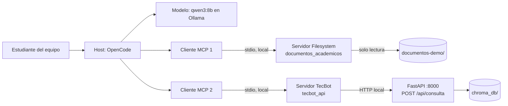

# Mapa de integración MCP — TecBot Académico

> Actividad del Día 3 · *Fundamentos de Model Context Protocol*. Mapa de capacidades y permisos, no solo lista de tecnologías.

## 1. Host, cliente y servidores

- **Host:** OpenCode. Es donde conversamos; descubre las tools de cada servidor y decide, con los permisos configurados, si el modelo puede usarlas.
- **Cliente:** el componente de OpenCode que mantiene una conexión con cada servidor (uno por servidor).
- **Servidores:** procesos locales por `stdio`; nada se expone a internet.

## 2. Capacidades por servidor y permisos

### Servidor 1 · `documentos_academicos` (MCP Filesystem, existente)

Alcance: **solo** `C:\Proyectos\tec_bot\documentos-demo`.

| Tipo | Nombre | Para qué | Permiso |
|---|---|---|---|
| Tool | `list_directory` | Ver qué documentos hay | `allow` |
| Tool | `read_file` | Leer un documento completo | `ask` (el humano ve qué archivo lee) |
| Tool | `search_files` | Buscar archivos por nombre | `allow` |
| Tool | `write_file` / `edit_file` / `move_file` / `create_directory` | Modificar el corpus | **`deny`** (regla 4 de `AGENTS.md`) |
| Resource | `file:///C:/Proyectos/tec_bot/documentos-demo/servicio-social.md` | Adjuntar un documento como contexto de solo lectura | — |

### Servidor 2 · `tecbot_api` (propuesto, propio)

Envuelve la API de TecBot para que un agente pueda probarla sin abrir el navegador.

| Tipo | Nombre | Para qué | Permiso |
|---|---|---|---|
| Tool | `consultar_tecbot(pregunta)` | Llamar `POST /api/consulta` y ver respuesta, fuentes y distancias | `allow` (solo lectura) |
| Tool | `reindexar()` | Ejecutar `scripts/indexar.py` y reconstruir `chroma_db/` | **`ask`** (borra y recrea la colección) |
| Resource | `tecbot://evaluacion` | Última tabla de `documentacion/evidencias/evaluacion-recuperacion.md` | — |
| Prompt | `revisar_respuesta(pregunta)` | "Consulta TecBot, verifica que cada fuente exista en documentos-demo/ y reporta diferencias" | — |

**Requieren aprobación humana:** `read_file` (para saber qué se lee) y `reindexar` (modifica estado). **Prohibidas:** todas las tools de escritura del Filesystem.

## 3. ¿Por qué el servidor de archivos no debe apuntar a todo el disco?

- **Mínimo privilegio:** TecBot solo necesita 4 documentos; dar acceso a `C:\` o a `C:\Users\...` expone `.env`, llaves SSH, credenciales del navegador, documentos personales y el propio `.git`.
- **El prompt no es un control de seguridad:** decirle al modelo "solo lee documentos-demo" no impide que una instrucción maliciosa (por ejemplo, dentro de un documento) lo lleve a leer otra ruta. El límite tiene que estar en la configuración del servidor y en los permisos de OpenCode.
- **Menos contexto y menos ambigüedad:** un alcance pequeño hace que `list_directory` y `search_files` devuelvan solo lo relevante.
- **Errores accidentales:** con escritura habilitada en todo el disco, un agente que se equivoca (como el que borró pruebas en el Día 2) podría dañar archivos fuera del proyecto.

## 4. RAG frente a MCP con un ejemplo del proyecto

**Pregunta:** "¿Qué necesito para iniciar el servicio social?"

| | RAG (lo que usa la app) | MCP (lo que usa el agente de desarrollo) |
|---|---|---|
| Quién lo usa | El estudiante, desde la página de TecBot | El equipo, desde OpenCode |
| Qué pasa | `app/busqueda.py` recupera los fragmentos indexados en ChromaDB **antes** de responder | El agente decide **durante** la conversación llamar `read_file("servicio-social.md")` |
| Resultado | Respuesta breve con la sección "Requisitos para iniciar" como fuente | El agente lee el documento completo para, por ejemplo, revisar si la respuesta de TecBot es fiel |
| Riesgo | Recuperar un fragmento poco útil (lo medimos: 7/9 con ChromaDB solo) | Ejecutar una acción no deseada (por eso escritura en `deny`) |
| Control | Umbral de distancia, `k`, búsqueda híbrida | Alcance a una carpeta, permisos `allow/ask/deny` |

**Conclusión:** no compiten. RAG responde a los estudiantes con fragmentos recuperados; MCP le da al agente de desarrollo acceso controlado a los documentos para revisar y mantener el proyecto. La aplicación en producción no necesita MCP.
